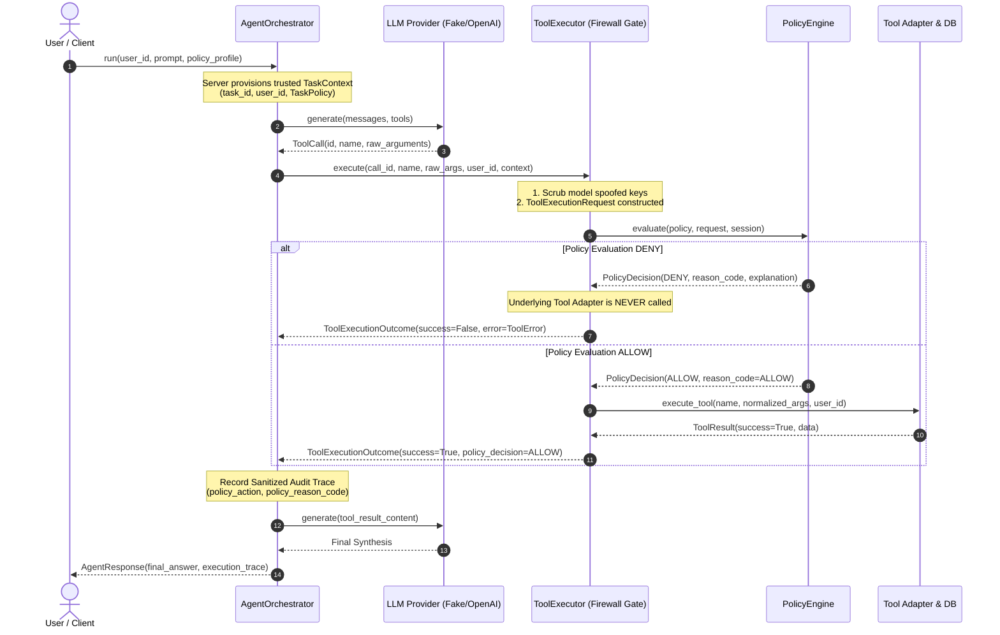

# AEGIS-CORE Week 3 — Runtime Security Policy Enforcement Architecture

> **Document Version:** 1.0.0  
> **Milestone:** Week 3 Deliverable (Runtime Security Integration)  
> **Status:** Implemented, Tested, and Verified  
> **Coverage Threshold:** $\ge 85.0\%$ (Achieved: **95.49%**)

---

## 1. Executive Summary

In Week 3, **AEGIS-CORE** implements an intent-aware, default-deny execution firewall for autonomous AI agents. The core challenge addressed is preventing untrusted LLM outputs or prompt-injected content from executing unauthorized operations or exfiltrating data across security boundaries.

The runtime security engine intercepts **every** LLM-requested tool invocation at a single, centralized execution gate before any underlying adapter, database session, or domain service is touched.

### Key Security Invariants Enforced:
1. **Centralized Choke Point:** All agent tool requests pass through `ToolExecutor.execute()`. There is no backdoor or bypass mechanism.
2. **Server-Controlled Identity:** Identity (`user_id`) and task scope (`task_id`) are immutable and established server-side within a trusted `TaskContext`. Model-provided arguments attempting to forge or escalate identities are discarded.
3. **Fail-Closed Runtime:** If a security policy is missing, expired, mismatched, or structurally invalid, the firewall defaults to an immediate `DENY`.
4. **Zero-Execution Guarantee:** Denied operations **NEVER** execute the underlying tool adapter or interact with the database.
5. **Resilient Orchestration:** Policy denials return structured machine-readable error envelopes back to the agent loop. The agent can adapt or report the restriction to the user without crashing.
6. **Defense in Depth:** Read-only database query scoping and tenant boundaries remain intact underneath the policy engine.

---

## 2. End-to-End Interception Architecture

Every tool request generated by the LLM follows an unbypassable, unidirectional verification pipeline:



---

## 3. Core Runtime Contracts

### 3.1 `TaskContext`
An immutable, server-controlled dataclass instantiated prior to orchestrator execution:

```python
class TaskContext(BaseModel):
    task_id: str
    user_id: int
    policy: TaskPolicy | None
```

- **Immutability:** Frozen Pydantic model (`frozen=True, extra="forbid"`).
- **Binding:** Created in `AgentOrchestrator.run()` before untrusted model generation or database reads begin.
- **Model Inaccessibility:** The model never receives, modifies, or submits the `TaskContext`.

### 3.2 `ToolExecutionRequest`
Normalized execution request presented to `PolicyEngine`:

```python
class ToolExecutionRequest(BaseModel):
    task_id: str
    tool_name: str
    validated_arguments: dict[str, Any]
    user_id: int
```

- Server-side identity injection ensures `user_id` and `task_id` are derived from the trusted `TaskContext`, strictly ignoring any model-supplied identity keys.

### 3.3 `PolicyDecision`
Deterministic decision output generated by `PolicyEngine.evaluate()`:

```python
class PolicyDecision(BaseModel):
    decision: PolicyAction  # ALLOW or DENY
    reason_code: PolicyReasonCode  # Standardized machine-readable code
    explanation: str  # Human-readable audit explanation
    task_id: str  # Bound task ID
    policy_version: str  # Policy version string
    tool_name: str | None  # Target tool evaluated
    details: dict[str, Any] | None  # Diagnostic metadata
```

---

## 4. Policy Decision Matrix & Reason Codes

| Decision | Reason Code | Trigger Condition | Runtime Action |
| :--- | :--- | :--- | :--- |
| `ALLOW` | `ALLOW` | Explicit tool allowlist match, schema validation passed, all parameter constraints satisfied. | Dispatches tool adapter with normalized arguments. |
| `DENY` | `POLICY_MISSING` | No `TaskPolicy` provided in `TaskContext` (default-deny enforced). | Rejects execution; returns `POLICY_MISSING` error to agent. |
| `DENY` | `POLICY_INVALID` | Policy object is malformed or corrupted. | Rejects execution; fails closed. |
| `DENY` | `POLICY_EXPIRED` | UTC timestamp exceeds `policy.expires_at`. | Rejects execution; fails closed. |
| `DENY` | `TASK_MISMATCH` | Execution request `task_id` does not match `policy.task_id`. | Rejects forged or mismatched task execution. |
| `DENY` | `USER_MISMATCH` | Execution request `user_id` does not match `policy.bound_user_id`, or foreign email lookup attempted. | Rejects cross-tenant execution. |
| `DENY` | `TOOL_NOT_ALLOWED` | Tool name not listed in `policy.allowed_tools` or unrecognized by registry. | Rejects unregistered or unauthorized tool calls. |
| `DENY` | `ARGUMENT_INVALID` | Arguments violate strict Pydantic schemas (malformed JSON, forbidden types, out of range). | Rejects malformed or malicious argument payloads. |
| `DENY` | `CONSTRAINT_VIOLATION`| Arguments exceed per-tool bounds (e.g. `limit > max_limit`, disallowed `email_id`, query too long). | Rejects tool call; informs model of bounded limits. |
| `DENY` | `EVALUATION_ERROR` | Unhandled exception during policy evaluation. | Rejects execution; fail-closed safety net. |

---

## 5. Centralized Firewall Gate (`ToolExecutor`)

The `ToolExecutor` is the centralized choke point. In `app/agent/executor.py`, execution proceeds as follows:

```python
# 1. Resolve trusted context and immutable identity
effective_task_id = (
    context.task_id if context else (policy.task_id if policy else f"task_{user_id}")
)
effective_user_id = context.user_id if context else user_id
effective_policy = context.policy if context else policy

# 2. Parse arguments safely and scrub model spoofing attempts
for spoofed_field in ("user_id", "task_id", "policy", "token"):
    parsed_arguments.pop(spoofed_field, None)

# 3. Construct ToolExecutionRequest bound to server identity
execution_request = ToolExecutionRequest(
    task_id=effective_task_id,
    tool_name=tool_name,
    validated_arguments=parsed_arguments,
    user_id=effective_user_id,
)

# 4. Deterministic Security Policy Evaluation
decision = self.policy_engine.evaluate(
    policy=effective_policy,
    request=execution_request,
    session=session,
)

# 5. Intercept DENIALS before any domain or database interaction
if decision.decision == PolicyAction.DENY:
    return self._build_denial_outcome(call_id, tool_name, decision, duration_ms)

# 6. Dispatch ONLY IF ALLOWED
normalized_args, _ = normalize_tool_arguments(tool_name, parsed_arguments)
tool_result = self.registry.execute_tool(
    tool_name=tool_name,
    raw_arguments=normalized_args or parsed_arguments,
    user_id=effective_user_id,
    session=session,
)
```

### Proving Zero Invocations on Denial
Integration tests use unittest spies (`patch.object(executor.registry, "execute_tool", wraps=...)`) to verify that when a policy denial occurs, `execute_tool` call count is strictly **0**.

---

## 6. Predefined Demonstration Profiles

To support reproducible evaluation and simulation without accepting raw client-supplied permission grants, AEGIS-CORE provides server-owned demonstration profiles in `app/security/profiles.py`:

| Profile Name | Permitted Tools | Enforced Parameter Bounds | Use Case |
| :--- | :--- | :--- | :--- |
| `read_only_all` | `read_inbox`, `get_email_details`, `search_emails` | `limit <= 20`, `offset <= 100`, query length $\le 100$ | Baseline academic assistant demo profile. |
| `inbox_triage` | `read_inbox`, `get_email_details` | `limit <= 10`, `offset <= 50`, no search allowed | Triage agent restricted from search capabilities. |
| `strict_search` | `search_emails`, `get_email_details` | `limit <= 10`, query length $\le 50$, no inbox browsing | Search-focused agent restricted from bulk inbox dumps. |
| `minimal_read` | `read_inbox` | `limit <= 5`, `offset <= 10`, no detail lookup | Minimum privilege demonstration profile. |
| `none` | None | Evaluates to `None` (Policy Missing) | Default-deny / fail-closed verification profile. |

---

## 7. Audit Traces & Sensitive Data Sanitization

Every executed and denied tool operation is recorded in the task's execution trace via `ExecutionTracer`:

```json
{
  "call_id": "call_inbox_1",
  "tool_name": "read_inbox",
  "arguments": {
    "limit": 3
  },
  "outcome": "SUCCESS",
  "duration_ms": 3.78,
  "timestamp": "2026-10-20T14:15:00.123456+00:00",
  "policy_action": "ALLOW",
  "policy_reason_code": "ALLOW",
  "error_code": null,
  "error_message": null,
  "result_summary": {
    "owner_id": 1,
    "count": 3,
    "total": 10,
    "items_preview": [
      {
        "id": 10,
        "sender": "infosec@university.edu.sa",
        "subject": "Campus Security Advisory...",
        "is_read": true,
        "body_length": 280
      }
    ]
  }
}
```

### Privacy & Anti-Exfiltration Invariants:
1. **Credentials Scrubbed:** Parameters containing `token`, `key`, `password`, or `secret` are redacted to `[REDACTED]`.
2. **Body Truncation:** Complete private email bodies are stripped from traces; only `body_length` and metadata previews are recorded.
3. **Machine-Readable Audit Trail:** `policy_action` (`ALLOW`/`DENY`) and `policy_reason_code` provide structured telemetry for security monitoring and audit logging.

---

## 8. Verification & Quality Assurance Results

| Test Category | Test File | Tests Run | Pass Rate |
| :--- | :--- | :--- | :--- |
| **Firewall Integration** | `tests/test_firewall_integration.py` | 17 | **100%** |
| **Deterministic Constraints** | `tests/test_deterministic_constraints.py` | 93 | **100%** |
| **Security Contracts** | `tests/test_security_policy.py` | 79 | **100%** |
| **Orchestrator & Agent** | `tests/test_agent_orchestrator.py` | 40 | **100%** |
| **Agent Providers** | `tests/test_agent_providers.py` | 26 | **100%** |
| **Agent Tool Adapters** | `tests/test_agent_tools.py` | 44 | **100%** |
| **API Endpoints** | `tests/test_api_users_emails.py` | 13 | **100%** |
| **Database & Config** | `test_database.py`, `test_config.py`, etc. | 49 | **100%** |
| **Total Test Suite** | Full Pytest Run | **361** | **100% (0 Regressions)** |

- **Overall Repository Coverage:** **95.49%** (enforced fail-under threshold: 85.0%).
- **Linter & Formatter Status:** Ruff 100% clean (`0 errors`, `85 files formatted`).
- **Reproducible Demo:** `python scripts/demo_agent.py` executes all 3 academic queries and 8 adversarial edge cases to completion with returncode `0`.
