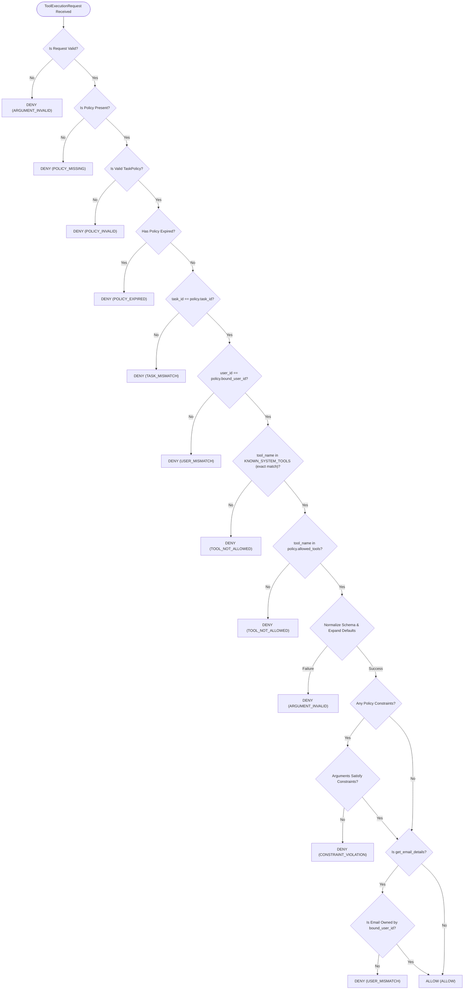

# AEGIS-CORE Week 3: Security Policy Engine & Data Contract Design

**Document Version:** 1.1.0  
**Status:** Approved for Implementation  
**Milestone:** Week 3 — Intent-Aware Execution Firewall Data Contracts & Deterministic Policy Engine  
**Author:** Principal Security Architect & Senior Application Security Engineer  
**Date:** October 20, 2026  

---

## 1. Executive Summary & Problem Statement

In autonomous AI agent systems, granting Large Language Models (LLMs) direct access to execution tools—such as mailbox readers, shell utilities, or corporate APIs—creates acute security risks:
1. **Indirect Prompt Injection:** Adversarial instructions embedded in retrieved data (e.g., untrusted emails or web pages) can trick the model into issuing unauthorized tool calls.
2. **Privilege Escalation:** An unconstrained agent loop can probe beyond intended boundaries, accessing unauthorized accounts or resources.
3. **Identity Forgery & Tenant Traversal:** Relying on the model to self-report tenant identities (`user_id`) permits cross-tenant traversal and data exfiltration.

To mitigate these threats deterministically, **AEGIS-CORE** introduces an **Intent-Aware Execution Firewall**. Week 3 establishes the foundation of this firewall: a deterministic, task-scoped, default-deny security policy engine (`app.security`) that evaluates every tool invocation request against immutable, server-issued authorization contracts before any tool code executes.

---

## 2. Security Invariants & Rules

The policy engine enforces a strict set of non-negotiable security invariants across all operations:

| # | Invariant | Description | Enforcement Mechanism |
|---|---|---|---|
| **1** | **Default Deny** | Any operation not explicitly permitted by an active policy is forbidden. | Unmatched tools or missing policies fail closed (`POLICY_MISSING`, `TOOL_NOT_ALLOWED`). |
| **2** | **No Wildcard Permissions** | Permissions must explicitly enumerate allowed tools. Wildcards (`*`, `.*`, `all`, `?`, `%`) are strictly forbidden. | Validated at policy construction time; raises `ValidationError`. |
| **3** | **Exact Tool Matching** | Tool names are matched via exact string equality. Regexes, prefixes, whitespace, or case-insensitive matching are disallowed. | Exact set containment `request.tool_name in policy.allowed_tools`. |
| **4** | **Schema Normalization & Default Expansion** | Authorization evaluates against exact active arguments after schema validation and default expansion. | `normalize_tool_arguments` expands omitted defaults (e.g., `limit=5`, `offset=0`) before constraint evaluation. |
| **5** | **Explicit Argument Constraints** | High-risk tool arguments (pagination limits, ID whitelists, keyword blacklists) must be explicitly constrained. | Typed Pydantic constraint models (`ReadInboxConstraint`, `GetEmailDetailsConstraint`, `SearchEmailsConstraint`). |
| **6** | **Task-Scoped Binding** | A policy is strictly tied to a unique `task_id`. Requests with mismatched task IDs are rejected. | Engine verifies `request.task_id == policy.task_id` (`TASK_MISMATCH`). |
| **7** | **Server-Controlled Identity** | Policies are bound to a verified `bound_user_id`. Agents and callers cannot alter or forge tenant identity. | Engine verifies `request.user_id == policy.bound_user_id` (`USER_MISMATCH`). |
| **8** | **Repository Ownership Boundary** | Foreign-user email lookups are denied even if a policy erroneously lists the ID. The database boundary remains inviolable. | `PolicyEngine` verifies email ownership against the repository session (`USER_MISMATCH`). |
| **9** | **Deterministic Search Without Heuristics** | Search constraints rely on explicit whitelists (`allowed_search_terms`), length bounds, and Unicode NFKC normalization—never fuzzy semantic intent guessing. | Normalized exact matching on `allowed_search_terms` and `blocked_search_terms`. |
| **10** | **LLM Cannot Modify Policy** | LLMs cannot create, modify, or approve their own permissions. Policies are server-issued and immutable. | Pydantic v2 `frozen=True` and `extra="forbid"` on all policy models. |
| **11** | **No Dynamic Code Execution** | No `eval()`, `exec()`, or dynamic imports are used anywhere in the policy pipeline. | Fully deterministic, static Python logic. |
| **12** | **Fail-Closed on Failure** | Missing, malformed, expired policies, or internal exceptions evaluate strictly to `DENY`. | Top-level fail-closed exception handling in `PolicyEngine.evaluate`. |

---

## 3. Core Data Contracts

The architecture is implemented in the `app.security` package using typed Pydantic v2 models:

```
app/security/
├── __init__.py           # Package exports and public interface
├── exceptions.py         # Security domain exception hierarchy
├── schemas.py            # Typed Pydantic v2 models, strict tool schemas, and enums
└── policy_engine.py      # Independent, deterministic evaluation engine
```

### 3.1 `TaskPolicy` Schema

The `TaskPolicy` represents an immutable authorization contract bound to a specific agent task:

```python
class TaskPolicy(BaseModel):
    model_config = ConfigDict(frozen=True, extra="forbid")

    task_id: str  # Unique task identifier
    bound_user_id: int  # Server-verified user identity
    allowed_tools: frozenset[str]  # Exact set of authorized tool names
    constraints: dict[str, BaseToolConstraint]  # Optional per-tool argument bounds
    policy_version: str = "1.0.0"  # Policy schema version
    issued_at: datetime  # UTC timestamp when issued
    expires_at: datetime | None = (
        None  # Optional UTC expiration timestamp (expires_at > issued_at)
    )
```

### 3.2 `ToolExecutionRequest` Schema

The execution request encapsulates the arguments and identity presented to the firewall:

```python
class ToolExecutionRequest(BaseModel):
    model_config = ConfigDict(frozen=True, extra="forbid", populate_by_name=True)

    task_id: str  # Active task correlation ID
    tool_name: str  # Target tool name to execute
    validated_arguments: dict[str, Any]  # Active tool arguments (alias: arguments)
    user_id: int  # Server-controlled simulated user identity (alias: bound_user_id)
```

### 3.3 `PolicyDecision` Schema

The evaluation decision provides deterministic, machine-readable outcomes:

```python
class PolicyDecision(BaseModel):
    model_config = ConfigDict(frozen=True, extra="forbid", populate_by_name=True)

    decision: PolicyAction  # ALLOW or DENY
    reason_code: (
        PolicyReasonCode  # Standardized reason code (e.g. ALLOW, TOOL_NOT_ALLOWED)
    )
    explanation: (
        str  # Human-readable explanation (aliases: reason, human_readable_explanation)
    )
    task_id: str  # Active task identifier
    policy_version: str = "1.0.0"  # Policy version evaluated
    tool_name: str | None = None  # Tool evaluated
    details: dict[str, Any] | None = None  # Diagnostic metadata
```

### 3.4 Per-Tool Constraint Specifications

1. **`read_inbox` Constraints ([`ReadInboxConstraint`](file:///c:/Users/ASUS%20TUF/Desktop/My%20Proj/app/security/schemas.py#L162)):**
   - `max_limit: int | None` (1..20): Restricts maximum messages returned per call. If omitted, defaults safely to tool maximum (20).
   - `max_offset: int | None` (ge=0): Restricts deep pagination. If omitted, any valid offset (`>= 0`) is allowed.
   - `allowed_is_read: bool | None`: Enforces strict read-status filtering (e.g. `False` permits only unread emails; `True` permits only read emails; `None` permits any).

2. **`get_email_details` Constraints ([`GetEmailDetailsConstraint`](file:///c:/Users/ASUS%20TUF/Desktop/My%20Proj/app/security/schemas.py#L211)):**
   - `allowed_email_ids: frozenset[int] | None`: Explicit email ID whitelist. If empty (`frozenset()`), all accesses are denied. If set, only enumerated IDs are permitted.
   - `denied_email_ids: frozenset[int] | None`: Explicit email ID blacklist. Cannot overlap with whitelist.
   - `max_email_id: int | None`: Upper bound on accessible email ID.
   - *Repository Boundary:* Regardless of policy configuration, looking up foreign-owned emails is strictly blocked by the repository ownership boundary.

3. **`search_emails` Constraints ([`SearchEmailsConstraint`](file:///c:/Users/ASUS%20TUF/Desktop/My%20Proj/app/security/schemas.py#L285)):**
   - `max_limit: int | None` (1..10): Restricts search result size.
   - `max_offset: int | None` (ge=0): Restricts pagination.
   - `max_query_length: int | None` (1..200): Enforces maximum query character length.
   - `min_query_length: int | None` (ge=1): Enforces minimum query length.
   - `allowed_search_terms: frozenset[str] | None`: Explicit whitelist of permitted search terms (case-folded, Unicode NFKC normalized). Empty whitelist denies all searches.
   - `blocked_search_terms: frozenset[str] | None` (alias `blocked_keywords`): Explicit blacklist of forbidden search terms.

---

## 4. Standardized Reason Codes

| Reason Code | Action | Description | Trigger Scenarios |
|---|---|---|---|
| `ALLOW` | **ALLOW** | Operation is explicitly authorized and satisfies all parameter constraints. | Compliant tool calls within policy limits. |
| `POLICY_MISSING` | **DENY** | No policy is attached to the task (default-deny enforced). | `policy=None` passed to engine. |
| `POLICY_INVALID` | **DENY** | The policy object is malformed or corrupted (fail-closed). | Non-`TaskPolicy` instance passed to engine. |
| `POLICY_EXPIRED` | **DENY** | The policy's expiration timestamp has elapsed. | `now > policy.expires_at`. |
| `TASK_MISMATCH` | **DENY** | The request's `task_id` does not match the policy's bound `task_id`. | Cross-task invocation or forged task ID. |
| `USER_MISMATCH` | **DENY** | The request's `user_id` does not match the policy's `bound_user_id`, or foreign email requested. | Cross-tenant traversal attempt or foreign email ID. |
| `TOOL_NOT_ALLOWED` | **DENY** | The requested tool is not in the policy allowlist, unknown to the system, or has case/prefix variations. | Unpermitted tool, unknown tool, `"Read_Inbox"`, `"read_inbox "`. |
| `ARGUMENT_INVALID` | **DENY** | Tool arguments fail strict schema validation, contain unknown fields, or violate parameter ranges. | Injected `user_id`, negative offset, limit > 20, missing `query`. |
| `CONSTRAINT_VIOLATION` | **DENY** | Active arguments violate policy parameter bounds or forbidden search terms. | Limit exceeds policy max, unwhitelisted email ID, blocked keyword. |
| `EVALUATION_ERROR` | **DENY** | An unhandled exception occurred during evaluation (fail-closed guarantee). | System exception trapped during evaluation. |

---

## 5. Evaluation Algorithm Flow



---

## 6. Concrete Policy & Authorization Examples

### Example 1: Bounded Read-Only Inbox Triage Policy
*Scenario:* An agent is tasked with summarizing recent unread emails. It cannot read full bodies or perform keyword searches. Omitted defaults (`limit=5, offset=0`) are expanded and evaluated safely.

```python
from app.security import ReadInboxConstraint, TaskPolicy

policy = TaskPolicy(
    task_id="task_summarize_inbox_01",
    bound_user_id=1,
    allowed_tools={"read_inbox"},
    constraints={
        "read_inbox": ReadInboxConstraint(
            max_limit=5,
            allowed_is_read=False,
        ),
    },
)
```

### Example 2: Scoped Message Inspection Policy with Foreign-Email Denial
*Scenario:* An agent is authorized to retrieve the details of email ID 3. Even if a policy maliciously declares foreign email ID 11, the repository boundary denies access.

```python
from app.security import GetEmailDetailsConstraint, TaskPolicy

policy = TaskPolicy(
    task_id="task_inspect_details_02",
    bound_user_id=1,
    allowed_tools={"get_email_details"},
    constraints={
        "get_email_details": GetEmailDetailsConstraint(
            allowed_email_ids=frozenset({3}),
        ),
    },
)
```

### Example 3: Prompt-Injection Resistant Arabic & Unicode Search Policy
*Scenario:* An agent is allowed to search academic emails using Arabic terms, with strict length bounds and credential keywords forbidden.

```python
from app.security import SearchEmailsConstraint, TaskPolicy

policy = TaskPolicy(
    task_id="task_search_academic_03",
    bound_user_id=1,
    allowed_tools={"search_emails"},
    constraints={
        "search_emails": SearchEmailsConstraint(
            max_limit=5,
            allowed_search_terms=frozenset({"جدول المحاضرات", "الامتحان"}),
            blocked_search_terms=frozenset({"كلمة السر", "password"}),
            max_query_length=60,
        ),
    },
)
```

---

## 7. Comprehensive Table-Driven Verification Matrix (20 Scenarios)

The test suite in [`tests/test_deterministic_constraints.py`](file:///c:/Users/ASUS%20TUF/Desktop/My%20Proj/tests/test_deterministic_constraints.py) verifies all 20 required authorization scenarios:

| # | Scenario | Test Input / Action | Evaluated Result |
|---|---|---|---|
| **1** | **Valid Permitted Tool Calls** | Permitted tool calls with valid arguments within limits. | `ALLOW (ALLOW)` |
| **2** | **Tool Not in Allowlist** | Requesting tool not permitted by policy (or unregistered tool). | `DENY (TOOL_NOT_ALLOWED)` |
| **3** | **Case Variations in Tool Names** | Cased or padded tool names (`"Read_Inbox"`, `"read_inbox "`, `"read_"`). | `DENY (TOOL_NOT_ALLOWED)` |
| **4** | **Limit Above Policy Maximum** | Requesting limit exceeding policy cap (e.g. `limit=6` when max=5). | `DENY (CONSTRAINT_VIOLATION)` |
| **5** | **Negative Offsets** | Negative pagination offset (`offset=-1`). | `DENY (ARGUMENT_INVALID)` |
| **6** | **Missing Required Arguments** | Omitted `email_id` in `get_email_details` or empty `query` in `search_emails`. | `DENY (ARGUMENT_INVALID)` |
| **7** | **Unknown Arguments** | Injected arguments (`user_id=2`, `fuzzy=True`, `body_only=True`). | `DENY (ARGUMENT_INVALID)` |
| **8** | **Omitted Defaults** | Empty arguments `{}` normalized to schema defaults (`limit=5`), then evaluated against policy max. | `ALLOW` if default $\le$ policy; `DENY (CONSTRAINT_VIOLATION)` if default $>$ policy. |
| **9** | **Disallowed Email IDs** | Email ID not in whitelist, in blacklist, or exceeding max ID. | `DENY (CONSTRAINT_VIOLATION)` |
| **10** | **Foreign-User Email Lookup** | User 1 requesting User 2's email ID 11 even when policy permits it. | `DENY (USER_MISMATCH)` |
| **11** | **Search Query Constraints** | Query exceeding length, below min length, or outside allowed terms. | `DENY (CONSTRAINT_VIOLATION)` |
| **12** | **Unicode and Arabic Search** | Arabic search queries evaluated with canonical NFKC normalization. | `ALLOW` for allowed Arabic terms; `DENY` for blocked terms. |
| **13** | **Expired Policies** | Request presented to policy past `expires_at`. | `DENY (POLICY_EXPIRED)` |
| **14** | **Invalid Task IDs** | Request presenting forged or mismatched `task_id`. | `DENY (TASK_MISMATCH)` |
| **15** | **Invalid Users** | Request presenting mismatched simulated `user_id`. | `DENY (USER_MISMATCH)` |
| **16** | **Unexpected Constraint Keys** | Declaring unrecognized constraint attributes (`arbitrary_code`, `unknown_field`). | Rejected during construction (`ValidationError`). |
| **17** | **Unauthorized Escalation Attempts** | Unpermitted tool dispatch, parameter injection, or task impersonation. | `DENY (TOOL_NOT_ALLOWED / ARGUMENT_INVALID / TASK_MISMATCH)`. |
| **18** | **Empty Allowed Tool List** | Constructing policy with `allowed_tools=set()`. | Rejected during construction (`ValidationError`). |
| **19** | **Missing Policy** | `policy=None` provided to engine. | `DENY (POLICY_MISSING)`. |
| **20** | **Malformed Policy Payloads** | Malformed dictionaries or non-policy objects. | `DENY (POLICY_INVALID)` or `ValidationError`. |

---

## 8. Quality Assurance & Test Coverage Summary

- **Total Automated Tests:** **344 passed in 6.36s** (0 failures, 0 regressions).
  - Week 1 & 2 Baseline Regression: 172 tests passed.
  - Week 3 Security Engine Tests: 79 tests passed (`tests/test_security_policy.py`).
  - Week 3 Table-Driven Constraints Tests: 93 tests passed (`tests/test_deterministic_constraints.py`).
- **Test Coverage:**
  - `app/security/schemas.py`: **98%**
  - `app/security/policy_engine.py`: **96%**
  - `app/security/exceptions.py`: **100%**
  - `app/security/__init__.py`: **100%**
  - **Combined Repository Coverage:** **96.44%** (exceeds 85% requirement).
- **Static Analysis & Formatting:** 100% clean Ruff checks (`ruff check .`, `ruff format --check .`).
