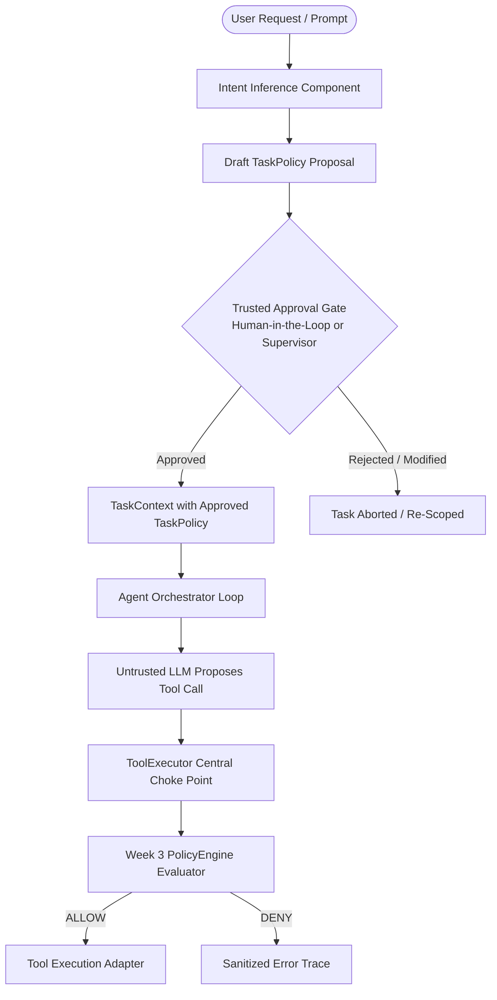

# AEGIS-CORE Week 4 Engineering Handoff Guide

**Document Version:** 1.0.0  
**Milestone Transition:** Week 3 (Deterministic Security Policy Engine) $\rightarrow$ Week 4 (Intent Inference & Dynamic Permission Proposal)  
**Author:** Independent Principal Security Auditor and Release Engineer  
**Audience:** Week 4 Intent Classification & Human-in-the-Loop Engineering Team  
**Date:** October 20, 2026  
**Status:** Approved for Next Milestone  

---

## 1. Executive Summary & Week 3 Foundation

Week 3 completed and verified the deterministic execution firewall for AEGIS-CORE:
- **Centralized Enforcement Gate:** Every tool invocation in `ToolExecutor.execute()` is intercepted and evaluated prior to dispatch.
- **Fail-Closed PolicyEngine:** Evaluates execution requests against an immutable, server-owned `TaskPolicy` with zero adapter calls on denial.
- **Argument Normalization:** Dispatches strict, normalized arguments identical to those authorized.
- **Empirical Security Verification:** 404 tests passing with 95.49% coverage. The comparative benchmark proved a 0.00% Unauthorized Execution Rate (UER) with an average evaluation latency of $128.55\ \mu\text{s}$.

---

## 2. The Week 4 Challenge: Dynamic Permission Proposal

In Week 3, policies were statically bound to tasks prior to execution using pre-configured profiles (`read_only_all`, `inbox_triage`, `strict_search`, `minimal_read`).

In **Week 4**, AEGIS-CORE transitions from static profile assignment to **dynamic intent-aware permission scoping**:
1. A user submits a high-level natural-language prompt (e.g., *"Find emails from Professor Layla about the homework deadline and summarize them"*).
2. The system dynamically infers the required tool permissions (e.g., `search_emails` with query constraint, followed by `get_email_details` for specific matching IDs).
3. The system generates a draft `TaskPolicy` proposal.
4. **Crucial Invariant:** The proposed policy is presented to a trusted authority (human user or automated supervisor test harness) for explicit approval *before* the agent executes tool calls.

> [!WARNING]
> **Week 4 Security Invariant:** The LLM that executes tasks MUST NOT approve its own proposed policy. Dynamic permission proposals must pass through an isolated classifier and require human-in-the-loop (HITL) or trusted supervisor confirmation before being installed into `TaskContext`.

---

## 3. Proposed Week 4 Architecture

### 3.1 Proposed Component Breakdown

1. **Intent Extraction & Policy Proposer (`app/security/intent.py`):**
   - Analyzes natural-language requests and extracts intended capabilities.
   - Derives minimal tool set and argument constraints (e.g., extracting search keywords to form `SearchEmailsConstraint(forbidden_substrings=...)`).
   - Generates an unapproved `DraftTaskPolicy`.

2. **Approval Gate Interface (`app/security/approval.py`):**
   - Presents the proposed policy to the client/caller.
   - Supports approval, rejection, or interactive constraint tightening.
   - Upon approval, seals the policy into an immutable `TaskPolicy`.

3. **Runtime Integration with `ToolExecutor`:**
   - No changes required to `ToolExecutor` or `PolicyEngine.evaluate()`.
   - The approved policy is passed directly to `AgentOrchestrator(policy=approved_policy)`.

---

## 4. Architectural Invariants for Week 4

1. **Separation of Concerns:** Intent classification must run in an isolated step, completely decoupled from the agent tool-calling loop.
2. **Principle of Least Privilege:** Dynamic policies must only request permissions strictly implied by the user's prompt.
3. **Fail-Closed on Ambiguity:** If the user request is ambiguous, the intent extractor must request clarification rather than proposing permissive wildcards.
4. **No Self-Granting Privileges:** The model executing the task cannot modify its permissions midway through the loop, even if it discovers new information in retrieved email content.
5. **Continuous Verification:** The 404 Week 1-3 test suite must remain green with zero regressions.

---

## 5. Reference Artifacts for Week 4 Developers

- Policy Schema Definitions: [`app/security/schemas.py`](file:///c:/Users/ASUS%20TUF/Desktop/My%20Proj/app/security/schemas.py)
- Policy Engine Evaluator: [`app/security/policy_engine.py`](file:///c:/Users/ASUS%20TUF/Desktop/My%20Proj/app/security/policy_engine.py)
- Trusted Runtime Context: [`app/security/context.py`](file:///c:/Users/ASUS%20TUF/Desktop/My%20Proj/app/security/context.py)
- Centralized Execution Gate: [`app/agent/executor.py`](file:///c:/Users/ASUS%20TUF/Desktop/My%20Proj/app/agent/executor.py)
- Security Verification Report: [`docs/week3-security-testing.md`](file:///c:/Users/ASUS%20TUF/Desktop/My%20Proj/docs/week3-security-testing.md)
- Week 3 Milestone Report: [`docs/week3-report.md`](file:///c:/Users/ASUS%20TUF/Desktop/My%20Proj/docs/week3-report.md)
