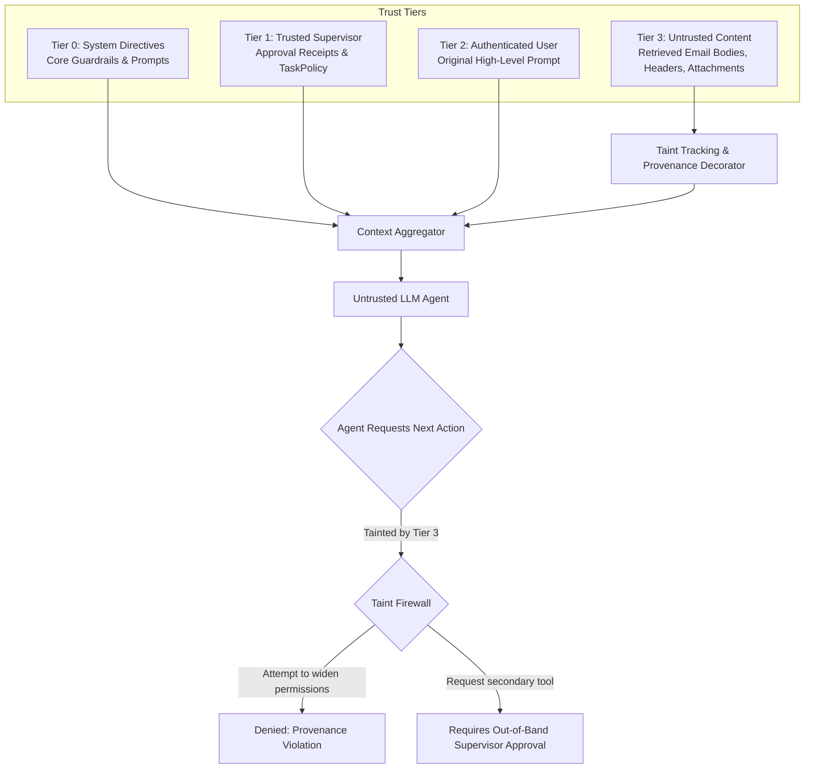

# AEGIS-CORE Week 5 Engineering Handoff Guide

**Document Version:** 1.0.0  
**Milestone Transition:** Week 4 (Intent Extraction, Least-Privilege Proposals & Trusted Approval) $\rightarrow$ Week 5 (Data Provenance Tracking & Trust-Tier Isolation)  
**Author:** Independent Principal Security Auditor, QA Lead, and Release Engineer  
**Audience:** Week 5 Architecture, Runtime, and Security Engineering Teams  
**Date:** October 20, 2026  
**Status:** Approved for Next Milestone  

---

## 1. Executive Summary & Week 4 Foundation

Week 4 designed, implemented, and rigorously verified the intent-to-policy authorization pipeline for AEGIS-CORE:
- **Deterministic Intent Extraction:** Strict multilingual parser (`app/intent/parser.py`) for English and Arabic requests with zero execution side effects.
- **Least-Privilege Permission Proposals:** Automated derivation of bounded permissions (`PermissionProposal`) mapping intents to exact Week 3 constraints (`app/intent/mappings.py`).
- **Explicit Trusted Approval Gate:** 5-state lifecycle (`PENDING` $\rightarrow$ `APPROVED` | `REJECTED` | `EXPIRED` $\rightarrow$ `CONSUMED`) enforcing an explicit local demonstration supervisor trust boundary (`X-AEGIS-Controller: local-supervisor`). Model self-approval is rejected (HTTP 403).
- **Secured Execution Endpoint:** `POST /api/v1/tasks/{task_id}/execute` resolving server-owned state with at-most-once execution guarantees.
- **Empirical Baseline:** 591 automated tests passing (100%), 94.70% statement and branch coverage, 0 regressions, and 100% accuracy on the 48-sample hold-out intent benchmark (`app/intent/evaluation.py`).

---

## 2. The Week 5 Challenge: Data Provenance & Trust-Tier Isolation

In Weeks 3 and 4, AEGIS-CORE established an active firewall *before* tool execution:
```
User Prompt (Untrusted) ──> Intent Parser ──> Proposal ──> Supervisor Approval (Trusted) ──> Immutable TaskPolicy
```
However, once authorized tools execute (e.g., `read_inbox` or `search_emails`), external data (email bodies, subjects, sender headers) enters the agent's context.

### The Security Gap (The "Confused Deputy" after Read)
Currently, retrieved email contents are returned to `AgentOrchestrator` as raw tool output strings. Even though the tool call itself was authorized, the content retrieved from external sources is **inherently untrusted**. In multi-step agent reasoning or dynamic tool chaining:
1. Malicious instructions embedded in email bodies (indirect prompt injection) attempt to trick the agent into requesting additional permissions or widening parameter boundaries.
2. The agent cannot distinguish between instructions originating from the verified user versus instructions found inside third-party email data.

In **Week 5**, AEGIS-CORE will solve this by implementing **Data Provenance Tracking and Trust-Tier Isolation**.

---

## 3. Core Week 5 Requirements & Architecture



### 3.1 Tracking Trusted vs. Untrusted Data Origins
Week 5 will categorize all context segments into explicit **Trust Tiers**:
- **Tier 0 (SYSTEM):** Immutable system prompts, core safety instructions, and runtime guardrails.
- **Tier 1 (SUPERVISOR):** Cryptographically signed approval receipts, server-owned `TaskPolicy` definitions, and supervisory overrides.
- **Tier 2 (USER):** High-level requests from authenticated user accounts (e.g., Dr. Layla Al-Mansoor).
- **Tier 3 (UNTRUSTED_EXTERNAL):** Data retrieved from external services, email bodies, subject lines, attachments, and search hit payloads.

### 3.2 Associating Tool Results with Provenance Metadata
Every output generated by `ToolExecutor` must be wrapped in a structured provenance envelope before being ingested into the agent's memory:
```python
class ProvenanceMetadata(BaseModel):
    origin_tier: TrustTier  # e.g., TrustTier.UNTRUSTED_EXTERNAL
    source_tool: str  # e.g., "read_inbox"
    source_identifier: str  # e.g., "email_msg_7"
    retrieved_at: datetime
    integrity_hash: str  # SHA-256 of raw tool payload
    taint_flags: set[str]  # e.g., {"external_input", "contains_markup"}
```

### 3.3 Preventing Lower-Trust Content from Widening Authorization
- **Taint Propagation:** If an agent's reasoning step incorporates Tier 3 data, any subsequent sub-intents or tool requests inherit Tier 3 taint.
- **Non-Executive Boundaries:** Tier 3 data must be encapsulated in structural data blocks (e.g., `<untrusted_external_content>` tags) to prevent the LLM from parsing it as system instructions.
- **Elevation Block:** An instruction bearing Tier 3 taint can **never** widen active `TaskPolicy` constraints, invoke tools outside `allowed_tools`, or generate self-approvals.

### 3.4 Preserving the Trusted Approval Boundary
- The approval gate (`PermissionApprovalService`) must remain strictly external to the agent execution loop.
- If a multi-step task requires expanding permissions (e.g. searching inbox reveals specific email IDs requiring `get_email_details`), the secondary proposal must be submitted back to the trusted supervisor controller (`X-AEGIS-Controller`) rather than self-authorized by the model.

### 3.5 Measuring Failures, False Positives, and Provenance Benchmarking
Week 5 must introduce an automated benchmark measuring:
1. **Taint Leakage Rate (TLR):** Rate at which Tier 3 instructions influence tool choice without supervisor review (Target: 0.00%).
2. **False Taint Denial Rate (FTDR):** Legitimate user instructions mistakenly flagged as tainted and blocked (Target: < 2.00%).
3. **Provenance Overhead:** Additional latency incurred by envelope wrapping and taint verification (Target: < 200 µs).

---

## 4. Invariants & Scope Restrictions

> [!IMPORTANT]
> **Week 4 Scope Boundary:** Full provenance tracking, taint tagging, and structural XML context encapsulation **must NOT be implemented during Week 4**. Week 4 is strictly limited to intent parsing, proposal generation, trusted approval, and task policy enforcement.

### Week 5 Invariants to Maintain:
1. **Never Trust Retrieved Text:** Assume any email body may contain hostile adversarial instructions.
2. **Immutable Approval:** Provenance mechanisms cannot alter or bypass the Week 4 approval state machine.
3. **Deterministic Enforcement:** Provenance validation must execute in deterministic code before LLM dispatch, never relying on LLM self-tagging.
4. **Preserve Baseline QA:** All 591 tests and 85%+ coverage requirement must remain green throughout Week 5 development.

---

## 5. Reference Artifacts for Week 5 Engineers

- Week 4 Testing & Security Audit: [`docs/week4-testing.md`](file:///c:/Users/ASUS%20TUF/Desktop/My%20Proj/docs/week4-testing.md)
- Week 4 Milestone Report: [`docs/week4-report.md`](file:///c:/Users/ASUS%20TUF/Desktop/My%20Proj/docs/week4-report.md)
- Approval State Machine: [`app/intent/approval.py`](file:///c:/Users/ASUS%20TUF/Desktop/My%20Proj/app/intent/approval.py)
- Task Execution Route: [`app/api/v1/routes/tasks.py`](file:///c:/Users/ASUS%20TUF/Desktop/My%20Proj/app/api/v1/routes/tasks.py)
- Sanitized Execution Tracer: [`app/agent/tracing.py`](file:///c:/Users/ASUS%20TUF/Desktop/My%20Proj/app/agent/tracing.py)
- Week 3 Policy Engine: [`app/security/policy_engine.py`](file:///c:/Users/ASUS%20TUF/Desktop/My%20Proj/app/security/policy_engine.py)
